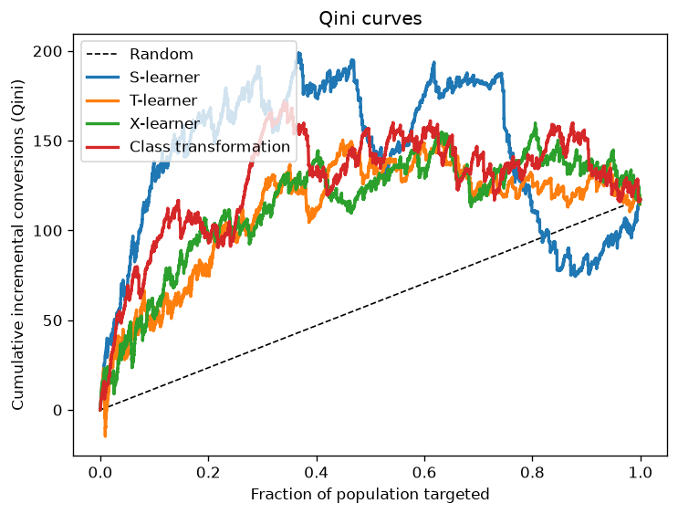
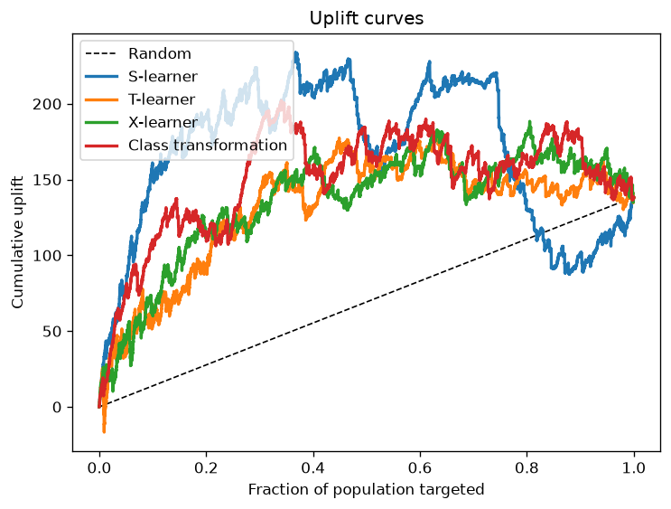
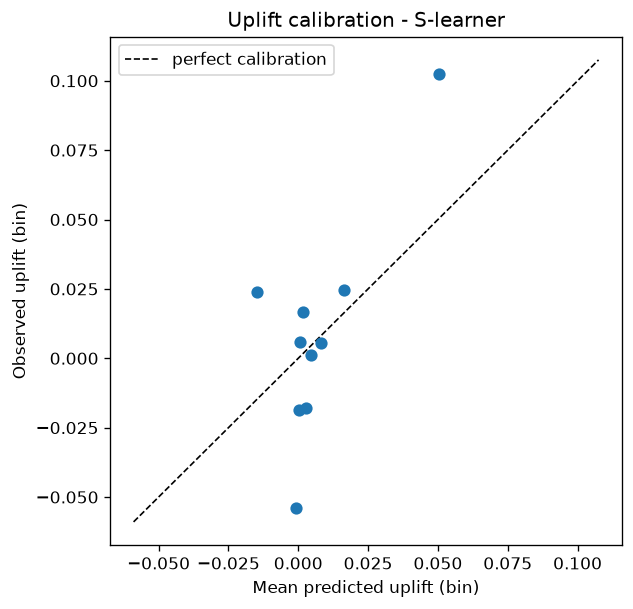

# Causal Uplift Modeling on the Criteo Incrementality Dataset

[](https://github.com/abhirammv2000/Causal-Uplift-Modeling/actions/workflows/ci.yml)


Estimating who to treat, not just who will convert. This project builds and
evaluates individual treatment-effect (uplift) models on the
[Criteo AI Lab](https://ailab.criteo.com/criteo-uplift-prediction-dataset/)
incrementality benchmark - a ~13.9M-user randomized controlled trial - to find
the customers whose behavior *changes* because of a marketing intervention.

> Classical response models rank people by `P(convert)`. But many of them would
> have converted anyway ("sure things"), and some are actively annoyed by being
> targeted ("sleeping dogs"). Uplift modeling ranks by **incremental**
> conversions, `P(convert | treated) - P(convert | not treated)`, which is the
> quantity that actually drives marketing ROI.

It is a Python package rather than a pile of notebooks: four uplift estimators
behind a common interface, the uplift metrics written from scratch with tests,
an instrumental-variable (CACE/Wald) analysis that goes from intent-to-treat to
the effect on the exposed, a one-command experiment runner, and a synthetic data
fallback so it runs straight after a clone.

---

## Headline results - on the real, full dataset

Four uplift estimators trained on the **real Criteo data** (13.98M users; a 2M
stratified subsample for modeling), evaluated on a held-out test set with proper
uplift metrics. Base learner: LightGBM.

| Model | Qini ↑ | AUUC ↑ | Uplift @ 10% | Uplift @ 30% |
|-------|:------:|:------:|:------------:|:------------:|
| S-learner           | 0.0946 | 0.0963 | 0.0622 | 0.0307 |
| X-learner               | 0.0792 | 0.0805 | 0.0613 | 0.0285 |
| T-learner               | 0.0692 | 0.0704 | 0.0584 | 0.0271 |
| Class transformation    | 0.0608 | 0.0623 | 0.0565 | 0.0246 |

*Qini / AUUC are normalized so 0 = random targeting and 1 = a perfect oracle.*

Bootstrapped 95% CIs (S-learner, 300 resamples) put Qini at 0.095 [0.082, 0.109]
and uplift@10% at 0.062 [0.054, 0.073], both well above zero.

A paired bootstrap (every model scored on the same resamples,
`evaluation.compare_models_bootstrap`) puts the S-learner ahead of the X-learner
(Qini difference 0.016, CI [0.004, 0.029]), the T-learner (0.025, [0.012, 0.040])
and class transformation (0.034, [0.019, 0.048]); none of those CIs contain zero.
The X-learner gap is the narrowest, and the bootstrap resamples only the test
set, so it ignores variation from retraining. Treat the S-over-X ordering as
likely rather than certain. Figures are from one run (seed 42).

The business reading: the average treatment effect on `visit` is only +0.0103,
a +27% relative lift over the 3.8% control rate. The model's top 10% of users
show an uplift of +0.062, about 6x the average, so spending on that decile
rather than on everyone is where the modeling earns its keep.

<p align="center">
  
  
  
</p>

> These numbers come from the full real dataset:
> `python scripts/download_data.py` then
> `python scripts/run_experiment.py --use-raw`. The repo also ships a small
> **synthetic** Criteo-like sample so everything (notebooks, tests, the default
> `run_experiment.py`) runs in seconds on clone without the ~290 MB download -
> see [data/README.md](data/README.md). Real data is not redistributed.

---

## Why this is a causal problem

The fundamental problem of causal inference is that we never observe both
outcomes for the same person - only treated-or-not. The Criteo data sidesteps
confounding because treatment was **randomized**, so:

- **Evaluation is unbiased by construction.** Ranking quality is measured against
  the real treated/control arms via the **Qini** and **uplift (AUUC)** curves -
  not classification accuracy, which is meaningless here.
- **The metrics are sign-aware and tested.** `tests/test_evaluation.py` asserts
  the properties that must hold: a perfect ranking beats random, a random
  ranking scores ≈ 0 Qini, and ranking by *anti*-uplift scores **below** random.
- **Uncertainty and calibration, not just a point score.** Every headline metric
  ships with a **bootstrap confidence interval**, and an **uplift calibration**
  curve checks that *predicted* uplift matches *realized* uplift per bin - a
  stronger claim than merely ranking units in the right order.
- Scope. Because Criteo is an RCT, this is heterogeneous treatment-effect
  estimation, not de-confounding of observational data. The
  X-learner and class-transformation models still carry the propensity machinery
  needed for the observational case (Criteo's assignment is a strongly imbalanced
  ~85/15), so the same code generalizes.

### From intent-to-treat to effect-on-the-exposed (CACE / IV)

Targeting and *exposure* are not the same thing: only a fraction of targeted
users were actually shown an ad (the `exposure` mediator). So every uplift number
above is **intent-to-treat** - the effect of being *targeted*, diluted by everyone
who was targeted but never saw an ad. Treating randomized assignment as an
**instrument** for exposure, the Wald estimator recovers the **complier average
causal effect (CACE / LATE)** - the effect on the users the ad actually reached:

```
CACE = ITT_Y / ITT_D = (effect of assignment on outcome) / (effect of assignment on exposure)
```

On the committed sample (`visit`): **ITT = +0.009**, first stage = 0.35, so
**CACE = +0.027** (95% CI excludes zero) - about 3× the ITT, because the effect is
concentrated in the third of users who actually saw the ad. This is the one
quasi-experimental method the dataset supports (one-sided non-compliance - a
control user is never exposed); it's `src/uplift/iv.py`, unit-tested in
`tests/test_iv.py`, and runs with:

```bash
python scripts/estimate_cace.py            # synthetic sample
python scripts/estimate_cace.py --use-raw  # full real data
```

---

## Methods

Four estimators spanning the standard uplift taxonomy, all behind one
`fit(X, y, t) -> predict_uplift(X)` interface (`src/uplift/models.py`):

| Estimator | Idea | Notes |
|-----------|------|-------|
| S-learner | One model on `[X, t]`; uplift = `mu(x,1) - mu(x,0)` | Simple, strong baseline |
| T-learner | Separate treated/control outcome models | Clean, can overfit small arms |
| X-learner | Impute per-unit effects, regress them, blend by propensity | Robust under treatment imbalance (Künzel et al. 2019) |
| Class transformation | Revert the label so one classifier learns uplift directly | Inverse-propensity reweighted for the 85/15 split (Jaśkowski & Jaroszewicz 2012) |

Base learners are pluggable: LightGBM, XGBoost, histogram GBDT, or
logistic/linear regression.

**Evaluation** (`src/uplift/evaluation.py`, all from scratch): Qini curve &
coefficient, uplift/AUUC curve & score, uplift@k, and weighted-average uplift.

---

## Repository layout

```
src/uplift/            Installable package
  config.py            Paths, dataset schema, ExperimentConfig
  data.py              Download, load, stratified sample, uplift-aware split
  models.py            S- / T- / X-learner + class transformation
  evaluation.py        Qini, AUUC, uplift@k, bootstrap CIs, calibration
  business.py          profit curves, ROI, optimal targeting depth
  iv.py                CACE / LATE via the Wald estimator (non-compliance)
  pipeline.py          load -> split -> fit -> evaluate, in one call
scripts/
  download_data.py     Fetch the full ~290 MB Criteo file
  make_sample.py       Build the committed sample (subsample real, or synthesize)
  run_experiment.py    Train all models, write reports/metrics.csv + figures
  estimate_cace.py     ITT vs. CACE: the effect on the *exposed*, not just targeted
app/
  streamlit_app.py     Interactive targeting / ROI explorer over the trained models
notebooks/             Narrative analysis (EDA -> meta-learners -> business case)
tests/                 pytest suite for metrics, models, and the pipeline
data/sample/           Small parquet sample so the repo runs out of the box
reports/figures/       Generated Qini / uplift curves
```

---

## Quickstart

```bash
pip install -r requirements.txt        # see docs/INSTALL.md (note on causalml)

python scripts/make_sample.py          # build data/sample (synthetic if no raw file)
python scripts/run_experiment.py       # train 4 models -> reports/metrics.csv + figures
pytest -q                              # run the test suite
```

Run on the full dataset:

```bash
python scripts/download_data.py
python scripts/run_experiment.py --use-raw --n-rows 2000000 --base-learner lgbm
```

Launch the interactive targeting / ROI explorer:

```bash
pip install streamlit
streamlit run app/streamlit_app.py     # set value/cost -> live profit curve + optimal depth
```

Use the package directly:

```python
from uplift import data, pipeline
from uplift.config import ExperimentConfig

df = data.load_sample()
result = pipeline.run_experiment(df, ExperimentConfig(outcome="visit"))
print(result.metrics)          # ranked metrics table
print(result.ate)              # observed average treatment effect
```

---

## Notebooks

Three notebooks, **all runnable** against the `uplift` package and the committed
sample (no Kaggle paths, no manual setup - each is executed with outputs):

0. [**Flagship analysis**](notebooks/00_flagship_uplift_analysis.ipynb) - the
   end-to-end story: data -> ATE -> ITT vs. CACE -> 4 models -> Qini/AUUC -> paired
   bootstrap (are the models really different?) -> calibration -> targeting payoff.
1. [**Exploratory data analysis**](notebooks/01_exploratory_data_analysis.ipynb)
 - base rates, two-proportion significance tests, a covariate-balance check
   that randomization holds, and the four uplift segments.
2. [**Business case**](notebooks/02_business_case_profit_curves.ipynb) - profit
   curves and ROI: the optimal targeting depth and what uplift targeting earns
   vs. treating everyone or targeting at random (`src/uplift/business.py`).

---

## Dataset

Criteo AI Lab Uplift v2.1: ~13.9M users, 12 anonymized features (`f0`-`f11`),
randomized `treatment` (~85% treated), an `exposure` mediator, and `visit` /
`conversion` outcomes. See [data/README.md](data/README.md) for schema and
download details.

## What I'd do next

Deliberately scoped out to keep this focused, but the natural extensions - and
the harder, more interesting causal questions - are:

- **Doubly-robust estimation (DR-learner).** Combine outcome and propensity
  models so the uplift estimate stays consistent if either is right - the modern
  default for robustness.
- **From RCT to observational.** Criteo is randomized, so confounding is handled
  for free. The harder tier - backdoor adjustment, sensitivity to *unobserved*
  confounding, overlap diagnostics - is where causal inference gets hard and
  would be the most valuable extension.
- **Model selection rigor.** Nested cross-validation and hyperparameter tuning
  with uplift-aware (Qini) scoring, rather than library defaults.

## References

- Diemert, Betlei, Renaudin, Amini. *A Large Scale Benchmark for Uplift Modeling*, AdKDD 2018.
- Künzel, Sekhon, Bickel, Yu. *Metalearners for estimating heterogeneous treatment effects*, PNAS 2019.
- Jaśkowski & Jaroszewicz. *Uplift modeling for clinical trial data*, ICML 2012.
- Gutierrez & Gérardy. *Causal Inference and Uplift Modelling: A Review*, 2017.

## License

MIT - see [LICENSE](LICENSE).
